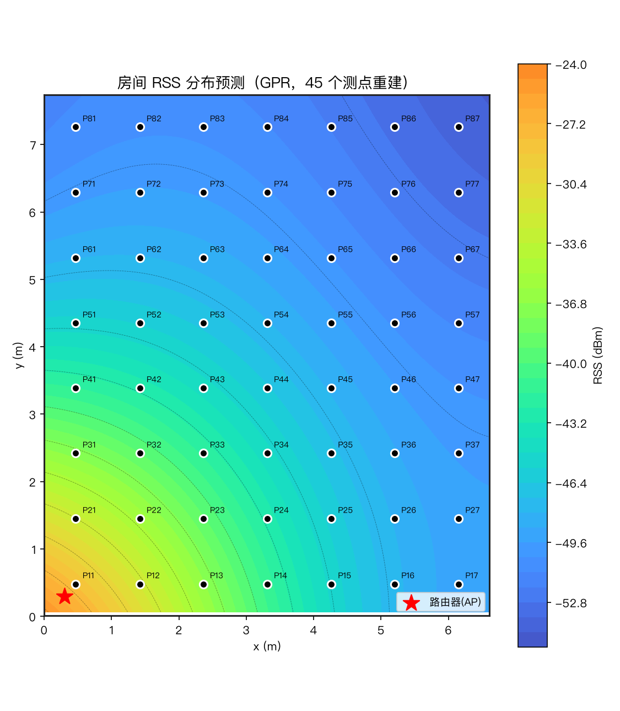
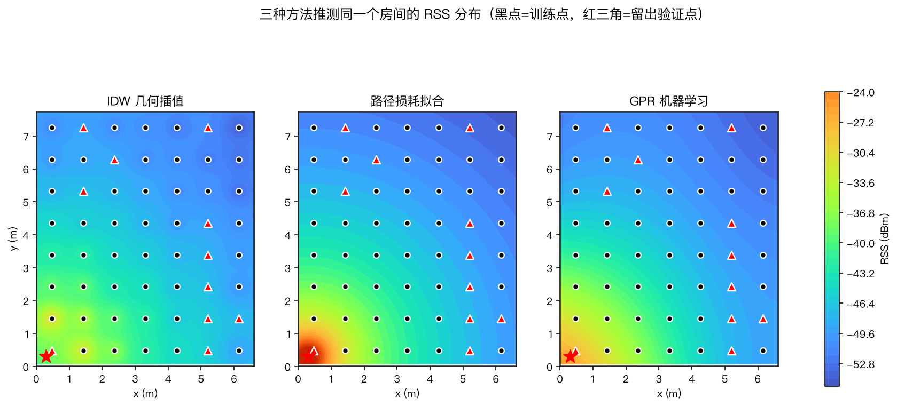

# Wi-Fi 热力图 · 一键采集网站

基于 **Wi-Fi CSI（信道状态信息）** 的室内人体存在/活动感知演示系统：在房间里按点位走一遍采集流程，系统自动训练模型并生成**信号强度热力图**。面向竞赛评审与教学演示设计，**零命令行、全流程网页操作**。

> 第三届"兴智杯"参赛作品 · 配套 [ESPectre](https://github.com/francescopace/espectre) 固件/采集器使用
>
> 🌐 **线上展示页**：https://carrotsoup123456.github.io/wifi-heatmap/

## 功能一览

| 模块 | 说明 |
|---|---|
| 🧭 四步引导流程 | 房型配置 → 数据采集 → 数据整理 → 建模出图，页面上一步一个按钮 |
| 🎭 演示 / 真实双模式 | 没有硬件也能完整演示（模拟数据）；接上 ESP32 板子即切换真实采集 |
| 🔥 一键烧录 & 配网 | 浏览器内直接烧录固件（WebSerial + esptool-js），Improv Serial 协议配 Wi-Fi |
| 📍 点位自动生成 | 输入房间尺寸自动布设测点（间距 1m，最多 100 点），支持 L 型等自定义房型 |
| 💾 实时保存 | 每采一个点立刻落盘 + 原子写入；崩溃重启后续采；**随时可下载** zip（含进度清单） |
| 📊 建模评估 | 支持 KNN / 随机森林 / SVR 三种模型；≥10 点自动 80/20 留出评估（seed 固定可复现） |
| 🗺️ 成果输出 | 预测热力图、实测 vs 预测对比图、模型评估报告、测点汇总表 |

## 效果展示（演示模式 · 56 测点）

| 预测热力图 | 实测 vs 预测 |
|---|---|
|  |  |

评估报告见 [outputs/模型评估报告.md](outputs/模型评估报告.md)；手动采集的操作说明见 [outputs/手动采集步骤图.html](outputs/手动采集步骤图.html) 与 [outputs/Wi-Fi热力图_数据采集操作手册.pdf](outputs/Wi-Fi热力图_数据采集操作手册.pdf)。

## 快速开始

```bash
# 1. 克隆（含 ESPectre 子模块）
git clone --recursive https://github.com/carrotsoup123456/wifi-heatmap.git
cd wifi-heatmap

# 2. Python 环境（3.10+）
python3 -m venv .venv && source .venv/bin/activate
pip install -r requirements.txt

# 3. ESPectre 采集器依赖
pip install -r tools/espectre/requirements.txt   # 如其存在，详见该目录 README

# 4.（可选，真实模式一键烧录需要）下载固件并校验
python3 scripts/download_firmware.py

# 5. 启动
python web/app.py    # 打开 http://127.0.0.1:8000
```

- **演示模式**：开箱即用，点「🪄 一键跑完全部点位」约 1 分钟即可看到完整流程与热力图。
- **真实模式**：ESP32（支持 classic / C3 / C5 / C6 / S2 / S3）烧录 ESPectre 固件并配网到 **2.4GHz** Wi-Fi（关闭 AP 隔离），在「采集设置」填板子 IP（多块用逗号分隔）即可开始采集。

## 目录结构

```
web/            Flask 网站（app.py 后端 + templates/static 前端，原生 JS 无构建）
  static/firmware/      固件清单 firmware.json（bin 文件用脚本下载）
scripts/        数据处理管线：01 汇总 → 04 建数据集 → 05 训练出图 + 房型点位生成
tools/espectre  ESPectre 采集器（git 子模块，GPLv3）
outputs/        演示模式生成的成果物（热力图 / 报告 / 汇总表 / 手册）
docs/           项目文档 + GitHub Pages 展示页
data/           采集数据与运行状态（运行时生成，不入库）
```

## 技术栈

- 后端：Flask（单进程本地服务）；数据处理：NumPy / SciPy / scikit-learn / Matplotlib
- 前端：原生 HTML/CSS/JS（无构建步骤）；烧录：esptool-js（Apache-2.0）
- 采集：ESPectre CLI（子进程驱动，数据经其输出归档为 npz）

## 许可与致谢

- 本仓库代码以 [MIT](LICENSE) 发布。
- [ESPectre](https://github.com/francescopace/espectre) © Francesco Pace，**GPLv3**；本仓库仅以子模块/下载脚本方式引用，未复制其源码或固件。
- [esptool-js](https://github.com/espressif/esptool-js) © Espressif，Apache-2.0；`web/static/vendor/` 内为官方发布的浏览器打包版。
- 演示模式下的信号强度与误差数据为**模拟生成**，仅用于流程演示。
